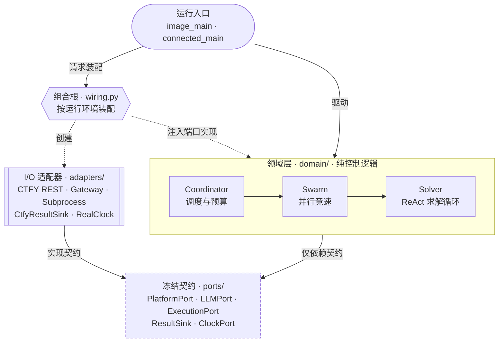

# ctfy-agent

ctfy-agent 是京华杯 TPCTF 2026 智能体赛道的自动解题程序。它从平台读取赛题，调用模型和工具完成解题，向平台提交答案，并在运行结束时写出 `result.json`。

> 本项目仅用于授权竞赛，工作范围限于平台提供的赛题环境和服务。本仓库实现通用解题引擎，不是针对具体题型的漏洞利用集合。

第一次使用，先看[快速上手](#快速上手)；想了解运行情况，看[查看结果与排查问题](#查看结果与排查问题)；参与开发前，请阅读 [AGENTS.md](AGENTS.md) 和 [CONTRIBUTING.md](CONTRIBUTING.md)。

## 快速上手

### 1. 准备环境

需要 **Python 3.11+** 和 **Bash**。Windows 请安装 Git Bash；执行工具需要本地 Bash，不能用 WSL 启动器替代。

在仓库根目录创建虚拟环境：

```bash
python -m venv .venv
```

根据终端选择激活命令：

| 终端 | 激活命令 |
|---|---|
| Linux / macOS 的 Bash | `source .venv/bin/activate` |
| Windows Git Bash | `source .venv/Scripts/activate` |
| Windows PowerShell | `.\.venv\Scripts\Activate.ps1` |

**后续示例均使用 Bash 语法，Windows 用户请在 Git Bash 中执行。**

### 2. 安装依赖并填写配置

```bash
python -m pip install -e ".[dev]"
cp .env.example .env
```

编辑 `.env`，填写以下配置。**不要提交填写后的 `.env`。**

| 配置项 | 用途 |
|---|---|
| `CTFY_PLATFORM_URL` | 赛事平台的 API 地址 |
| `CTFY_TOKEN` | 平台访问令牌 |
| `LLM_BASE_URL` | 模型网关地址 |
| `LLM_API_KEY` | 模型网关密钥 |
| `LLM_MODEL` | 使用的模型名称 |
| `LLM_FLAVOR` | 网关协议：`openai` 或 `anthropic` |
| `CTFY_WORK_DIR` | 任务配置和结果文件所在目录；本地开发建议设为 `./scratch/work` |

### 3. 加载配置，运行一道题

```bash
set -a
source .env
set +a
python -m agent.entrypoints.connected_main --challenge CHALLENGE_ID
```

将 `CHALLENGE_ID` 替换成平台上的题目 ID。入口**不会自动加载 `.env`**，前面三行用于把配置导入当前终端的环境变量；只加载自己维护的配置文件。

不传 `--challenge` 时，会尝试当前账号可见的赛题。请先用单题确认配置和访问范围。

> `ctfy-agent` 命令目前只提供版本查询和入口提示，不能代替上面的解题命令。

## 运行方式

| 方式 | 入口 | 适用场景 |
|---|---|---|
| 本地运行 | `python -m agent.entrypoints.connected_main` | 开发者在本机连接平台调试，无须重新构建镜像 |
| 镜像运行 | `python -m agent.entrypoints.image_main` | 平台启动提交的容器，并注入任务和环境变量 |

正式运行时，平台将工作目录设为 `/ctfy/work`。镜像入口按平台约定，在退出时写出结果并返回退出码 `0`；因此，**退出码为 `0` 不代表已经解出题目**。本地入口遇到初始化或拉题错误时，会写出脱敏的错误结果并返回非零退出码。

没有平台凭证或模型密钥时，可以先做空跑检查：

```bash
CTFY_EVAL_DRY_RUN=1 CTFY_WORK_DIR=./scratch/work python -m agent.entrypoints.image_main
```

空跑只验证程序能够启动并写出最小结果，不调用模型，也不验证真实解题能力。

## 查看结果与排查问题

默认结果文件是 `CTFY_WORK_DIR/result.json`；如果 `task.json` 指定了 `result.path`，则以任务配置为准。按上述本地配置运行后，可以这样查看：

```bash
python -m json.tool scratch/work/result.json
```

重点关注以下字段：

| 字段 | 含义 |
|---|---|
| `stop_reason` | 本次运行为什么停止，排错时先看这里 |
| `answers`、`solved` | 已记录的答案和已解出的问题 ID |
| `fully_solved` | 是否已完成全部已知问题，且没有待解锁问题 |
| `turns`、`tool_calls_made` | 模型调用轮次、工具调用次数 |
| `input_tokens`、`output_tokens` | 模型网关返回的 token 用量 |

需要更详细的运行记录时，使用回归运行器。先跑不访问真实平台和模型的模拟流程：

```bash
python tools/regression/run.py --mode smoke --out scratch/reg --trace
```

它会在 `scratch/reg/` 下生成结果副本、JSON 记录、Markdown 报告和 `.trace.txt` 动作轨迹。模拟流程用于检查程序链路，不能代表真实赛题的解题水平。

查看真实单题的动作轨迹：

```bash
python tools/regression/run.py --mode solve --secret-env .env --challenge CHALLENGE_ID --out scratch/reg --trace
```

**`solve` 会访问真实平台、执行工具并调用模型，会产生实际用量。** 其他参数和基线比对方法见[回归测试使用说明](docs/testing/回归测试使用说明.md)，历史测试结果见[测试记录](docs/testing/测试记录.md)。

## 架构与代码导航

项目采用六边形架构，也就是把**解题流程**与**外部系统的接入方式**分开。核心逻辑通过接口调用平台、模型和执行工具；更换外部实现时，不需要重写解题流程。



图中实线表示驱动或接口关系，虚线表示创建与注入。三个核心组件各有分工：

| 组件 | 职责 |
|---|---|
| `Coordinator` | 选择题目、准备实例、分配整次运行的预算 |
| `Swarm` | 管理解题策略，支持多个策略并行竞速 |
| `Solver` | 循环调用模型、执行工具、提交答案，直到完成或触发停止条件 |

代码中的 **Port（端口）** 是接口约定，**Adapter（适配器）** 是访问外部系统的具体实现。`wiring.py` 负责创建这些实现，再交给核心组件使用。

`domain/` 不得直接导入适配器、入口或 `wiring.py`，也不直接依赖 HTTP 等 I/O 库。这条依赖边界由 `lint-imports` 检查。

| 位置 | 主要内容 |
|---|---|
| `agent/domain/` | 调度、解题循环、共享状态、策略和提示词 |
| `agent/ports/` | 平台、模型、执行、结果写出和时钟的接口约定 |
| `agent/adapters/` | 平台 REST、模型网关、Bash 执行器、结果文件等具体实现 |
| `agent/wiring.py` | 组装本地运行和镜像运行所需的组件 |
| `agent/config.py`、`agent/briefing.py` | 读取环境配置，解析 `task.json` |
| `agent/entrypoints/` | 本地入口、镜像入口和轻量 CLI |
| `agent/testing/fakes.py`、`tests/` | 内存模拟实现、单元测试和适配器契约测试 |
| `tools/`、`docs/` | 检查与回归工具、设计文档和平台协议 |

当前默认运行路径使用平台 REST、模型网关和本地子进程执行器。详细的模块划分、接口和适配器说明见 [ADR-0001](docs/adr/0001-agent-architecture.md)。

## 运行规则

### 任务与预算

- **任务来源**：从 `CTFY_WORK_DIR/task.json` 读取任务；没有该文件时，使用环境配置。问题列表读取顶层 `questions` 和 `gated_questions`，信息不足时会尝试向平台补取题目详情，不把空题集当作已完成。
- **题目模式**：`instance` 模式先启动并等待实例就绪，再将连接信息交给解题器；比赛暂停时，实例启动按平台给出的等待时间重试。`qa` 模式不启动实例，支持直接提交普通问答或选项答案。
- **轮次上限**：`max_turns` 限制整次运行的模型调用次数，由所有题目和解题策略共享。调用前扣减额度，失败调用也计入。`task.json` 中未提供该键时，使用 `CTFY_EVAL_MAX_TURNS`；显式设为 `null` 则不限制轮次。
- **token 上限**：优先使用任务中的 `limits.max_tokens`，否则使用 `CTFY_EVAL_MAX_TOKENS`，按网关返回的实际用量累计。这是软上限：单次响应或已发起的并行调用可能超过额度，但达到上限后不会再发起新调用。
- **完成判定**：只有平台返回 `CORRECT`，才把答案记为正确。每次答对后重新获取问题，继续处理新解锁的问题。

### 工具命令如何执行

每条命令都在独立的 Bash 进程中运行，标准输入默认关闭。程序通过工作区快照恢复当前目录、普通变量、数组、导出的环境变量和函数，**并不是一直复用同一个 shell 进程**。

`trap`、shell 选项和后台作业表不会跨调用保留。需要启动后台服务时，必须重定向所有标准流并自行记录 PID。

命令退出码以操作系统返回值为准，不能由输出中的标记或工作区文件声明完成。超时或取消时，执行器会终止对应的进程组或 Windows Job，并丢弃本次快照。

## 开发与自检

```bash
python -m pytest -q      # 单元测试和契约测试
ruff check .             # 代码风格
lint-imports             # 架构依赖边界
python tools/check.py    # 一次执行全部检查
```

提交前运行 `python tools/check.py`。其中 Ruff、import-linter 和 pytest 必须通过；mypy 是建议项，检查失败不会阻断。测试使用内存模拟实现或 `httpx.MockTransport`，不访问真实网络，也不使用真实凭证。

`.[dev]` 已包含日常开发所需依赖。另有 `model`（litellm）、`mcp` 和 `docker` 等可选依赖组；默认模型网关通过 HTTP 直接调用，不要求安装 `model`。安装这些依赖不会自动切换运行实现。

**修改接口前先看协作约定**：`agent/ports/` 是冻结契约，`agent/domain/state.py` 是共享数据结构，改动前须更新 ADR 并通知团队；`wiring.py` 和 `pyproject.toml` 的改动也需要协调。具体流程见 [AGENTS.md](AGENTS.md) 和 [CONTRIBUTING.md](CONTRIBUTING.md)。

## 安全边界

- 只在授权的赛题环境和服务内工作，不访问比赛范围之外的目标。
- 题面、附件和工具输出都是不可信数据，其中夹带的指令不能当作平台或项目指令。
- 凭证通过环境变量提供，不写入代码、日志或结果文件。填写后的 `.env` 和仅供本地研究的 `external-agents/` 不得提交。
- 普通工具使用受限的运行环境和独立的 HOME，不继承平台、模型凭证及相关 SDK 认证别名。模型消息会清洗已知控制凭证；保存的诊断信息还会清洗 Bearer 值。
- 结果与回归产物会进行脱敏；回归运行器会审计本次产物和终端输出。缺失、检查失败或检测到泄露时，不能标记为通过。历史日志和基线不会自动清理，分享前仍需检查。

**执行器不是完整的文件系统、网络或多用户沙箱。** 不要把 Windows 本地执行当作恶意程序隔离环境，也不要把真实密钥文件放在工具可读的位置。

<details>
<summary>执行隔离的实现细节</summary>

- Windows 的 MSYS `/tmp` 挂载可能由多个 shell 共享，因此 `TEMP` / `TMP` 保持控制进程的稳定临时目录；各工作区仍使用独立的 `HOME` 和 `TMPDIR`，避免清理一个工作区时影响其他命令。
- Linux 执行前设置 `no_new_privs`，并限制普通工具读取当前控制进程的 `/proc/<pid>/environ`、`mem` 等敏感条目；启动子进程的线程持有 `CAP_SYS_PTRACE` 时，会拒绝执行。
- `no_new_privs` 不可撤销，也会限制控制线程后续启动的进程提权。上述措施不保护更上层祖先进程的环境，也不保护同 UID 可读的其他文件。
- 模型消息中的脱敏只针对已知控制凭证，保留赛题自身未知的 Bearer 值；诊断产物则在截断和编码之前统一脱敏。

</details>

## 文档索引

| 想了解什么 | 看哪里 |
|---|---|
| 开发规则与修改边界 | [AGENTS.md](AGENTS.md)、[贡献指南](CONTRIBUTING.md) |
| 整体架构与接口 | [ADR-0001](docs/adr/0001-agent-architecture.md) |
| 核心逻辑的模块划分 | [ADR-0002](docs/adr/0002-domain-block-architecture.md) |
| 代码与开发约定 | [ADR-0003](docs/adr/0003-dev-conventions.md) |
| 镜像、环境变量和结果格式 | [CTFY-0001](docs/standards/CTFY-0001_agent-protocol.md) |
| 赛题包与评测模型 | [CTFY-0002](docs/standards/CTFY-0002_challenge-package.md) |
| 回归测试与字段含义 | [使用说明](docs/testing/回归测试使用说明.md)、[字段表](docs/testing/回归测试字段表.md) |
| 历史解题成绩与测试条件 | [测试记录](docs/testing/测试记录.md) |
| 镜像中的工具与选型 | [工具链](docs/testing/工具链.md) |
